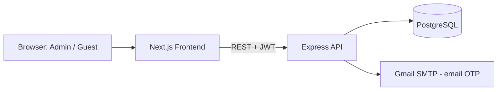
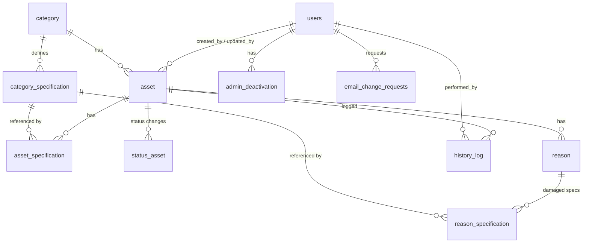

# Assetra - Technical Documentation

Dokumentasi teknis untuk developer / maintainer. Panduan pemakaian untuk end-user ada di [user-manual.md](./user-manual.md).

## 1. Overview

**Assetra** adalah aplikasi web untuk *pelacakan (tracking) dan pendataan barang* melalui QR code. Fokusnya adalah mencatat barang, kategori, spesifikasi, status, dan riwayat perubahan. Aplikasi ini **bukan** sistem akuntansi aset (tidak ada depresiasi, nilai finansial, atau procurement).

| Komponen | Teknologi |
|---|---|
| Frontend | Next.js (App Router), i18n routing `[locale]` (en / id), Tailwind CSS |
| Backend | Node.js + Express (REST API) |
| Database | PostgreSQL |
| Auth | JWT (Bearer token), role-based access |
| Email (OTP) | Nodemailer + Gmail SMTP |
| Export | `pdfkit` (PDF), `exceljs` (Excel) |
| Deployment | Vercel (frontend & backend) |

**Link penting**
- Aplikasi: https://assetra-navy.vercel.app
- Repository: https://github.com/Axel-monix/assetra
- Video demo: https://drive.google.com/drive/folders/1K30A0z_ZyhoD-FUYCQGZh3L3lqtEvQO4?usp=sharing

### Role

| Role | Hak akses |
|---|---|
| Guest | Scan QR, melihat info & status barang (read-only) |
| Admin | CRUD kategori/spesifikasi/barang, ubah status, generate & cetak QR, lihat & export history |
| Super Admin | Semua hak Admin + kelola akun Admin (tambah, aktif/nonaktifkan) |

> Satu deployment = satu organisasi (tidak multi-tenant).

## 2. Arsitektur



Alur singkat:
1. User membuka frontend (Next.js) dan login. Backend mengembalikan JWT.
2. Frontend menyimpan token dan mengirimnya di header `Authorization: Bearer <token>`.
3. Middleware backend memverifikasi token dan role sebelum controller dijalankan.
4. QR code hanya berisi link statis (`/items/<kode-barang>`), bukan snapshot data. Jadi edit barang tidak mengharuskan QR dicetak ulang. Kode barang harus tetap stabil setelah QR dicetak.
5. Halaman scan memakai endpoint publik dengan *optional auth*: tanpa token = Guest (read-only), dengan token valid = Admin/Super Admin (bisa edit/nonaktifkan).

## 3. Setup & Menjalankan

Prasyarat, langkah instalasi, dan cara menjalankan project ada di [README](../README.md#setup--menjalankan).

### Environment Variables

> Sesuaikan nama variabel dengan file `.env` yang dipakai. **Jangan commit nilai asli.** Commit hanya `.env.example`.

**Backend**

| Variabel | Keterangan |
|---|---|
| `DATABASE_URL` / `DB_*` | Koneksi PostgreSQL |
| `JWT_SECRET` | Secret untuk menandatangani JWT |
| `GMAIL_USER` | Alamat Gmail pengirim OTP |
| `GMAIL_APP_PASSWORD` | App Password Gmail |
| `APP_URL` | Base URL frontend (dipakai untuk isi QR code) |

**Frontend**

| Variabel | Keterangan |
|---|---|
| `NEXT_PUBLIC_API_URL` | Base URL backend API |

## 4. Struktur Folder

```
assetra/
  package.json              # script root (dev, dev:backend, dev:frontend, install:all)
  README.md
  docs/
  backend/
    server.js
    constants/response.js
    src/
      config/db.js          # koneksi PostgreSQL
      controllers/          # logika bisnis per domain
      routes/               # definisi endpoint
      middleware/           # auth & role
      utils/                # helper (history logger, mailer, password, QR, kode reset)
  frontend/
    app/[locale]/           # halaman: login, forgot-password, history,
                            # manage-admin, manage-items, manage-categories,
                            # printQr, profile, items/[code]
    components/
      admin/                # form & modal admin
      categories/           # category & specification builder
      common/               # pagination, searchBar, loading, language switcher
      dashboard/            # layout, header, overview, stat card
      history/              # filter, item, export modal
      items/                # form, card, detail panel, modal need repair
    lib/                    # fonts, colors, constants, helper (item, history, status)
    messages/               # en.json, id.json (terjemahan)
```

### Backend

| Folder | Isi |
|---|---|
| `controllers/` | `adminController`, `assetController`, `authController`, `categoryController`, `forgotPasswordController`, `historyController`, `indexController`, `userController` |
| `routes/` | `adminRoutes`, `assetRoutes`, `authRoutes`, `categoryRoutes`, `historyRoutes`, `uploadRoutes`, `index` |
| `middleware/` | `authMiddleware` (verifikasi JWT, isi `req.user`), `roleMiddleware` (`authorizeRoles(...)`), `requireSuperAdmin`, plus `optionalAuth` untuk endpoint publik |
| `utils/` | `historyLogger`, `mailer`, `password`, `qrGenerator`, `Resetcode` |

### Konvensi frontend
- Warna dari `lib/colors.js` / CSS variable, font dari `lib/fonts.js`, pesan dari `lib/constants.js` (tidak di-hardcode di komponen).
- Teks UI lewat i18n (`messages/en.json`, `messages/id.json`).

## 5. Database

Tabel utama:

| Tabel | Fungsi |
|---|---|
| `users` | Akun admin / super admin (role, status, last_login) |
| `category` | Kategori barang |
| `category_specification` | Definisi spesifikasi per kategori (nama, tipe: text/number/date/boolean, required, repairable) |
| `asset` | Barang (kode, nama, kategori, status, lokasi, gambar, QR) |
| `asset_specification` | Nilai spesifikasi tiap barang (`id_asset`, `id_specification`, `spec_key`, `spec_value`) |
| `status_asset` | Riwayat perubahan status barang |
| `reason` | Alasan perubahan status (need repair / nonaktif) |
| `reason_specification` | Spesifikasi yang ditandai rusak pada satu laporan need repair |
| `history_log` | Feed riwayat terpusat untuk halaman History |
| `admin_deactivation` | Alasan penonaktifan akun admin |
| `password_reset_requests` | Kode OTP reset password |
| `email_change_requests` | Kode OTP perubahan email |

Status barang (`asset_status`): `functional`, `needs_repair`, `unavailable`.

Relasi:



Catatan desain:
- Primary key selalu `id`; foreign key berawalan `id_` (contoh `asset.id_category`).
- Menghapus kategori ditolak jika masih ada barang yang memakainya.
- Spesifikasi yang sudah dipakai barang tidak ikut terhapus saat definisi diubah; spec_key menyimpan cache nama.
- Perubahan status barang dicatat otomatis oleh trigger `trg_asset_status_history`.

## 6. API Reference

Base URL lokal: `http://localhost:5000/api`. Semua endpoint (kecuali yang ditandai *publik*) membutuhkan header `Authorization: Bearer <token>`.

> Tabel berikut dikelompokkan per route file. Cocokkan path dan method dengan isi `src/routes/*` sebelum dikumpulkan.

### Auth & akun

| Method | Endpoint | Akses | Fungsi |
|---|---|---|---|
| POST | `/auth/login` | Publik | Login, mengembalikan JWT |
| POST | `/auth/forgot-password` | Publik | Kirim OTP reset ke email |
| POST | `/auth/verify-reset-code` | Publik | Verifikasi OTP |
| POST | `/auth/reset-password` | Publik | Set password baru |
| PATCH | `/users/me` | Login | Ubah nama sendiri |
| POST | `/users/me/email-change/request` | Login | Minta ganti email (kirim OTP ke email baru) |
| POST | `/users/me/email-change/verify` | Login | Verifikasi OTP ganti email |

### Admin (Super Admin only)

| Method | Endpoint | Fungsi |
|---|---|---|
| GET | `/admins` | Daftar admin (termasuk last_login) |
| POST | `/admins` | Tambah admin |
| PATCH | `/admins/:id/status` | Aktifkan / nonaktifkan admin (nonaktif wajib alasan) |

### Kategori & spesifikasi

| Method | Endpoint | Akses | Fungsi |
|---|---|---|---|
| GET | `/categories` | Login | Daftar kategori + spesifikasi |
| GET | `/categories/:id` | Login | Detail kategori + spesifikasi |
| POST | `/categories` | Admin+ | Buat kategori + spesifikasi |
| PUT/PATCH | `/categories/:id` | Admin+ | Ubah kategori (upsert spesifikasi) |
| DELETE | `/categories/:id` | Admin+ | Hapus kategori (ditolak jika dipakai barang) |

### Barang (asset)

| Method | Endpoint | Akses | Fungsi |
|---|---|---|---|
| GET | `/assets/public/:code` | **Publik** (optional auth) | Info barang untuk halaman scan QR; respons memuat `viewer` dan `permissions` |
| GET | `/assets` | Login | Daftar barang + spesifikasi + detail kerusakan |
| POST | `/assets` | Admin+ | Tambah barang |
| PUT/PATCH | `/assets/:id` | Admin+ | Ubah barang; kirim `repair: { specIds, details }` saat status menjadi `needs_repair` |
| PATCH | `/assets/deactivate` | Admin+ | Nonaktifkan barang (bulk, dengan alasan) |

### History

| Method | Endpoint | Fungsi |
|---|---|---|
| GET | `/history` | Daftar riwayat (filter tipe, pencarian, tanggal; paginasi) |
| GET | `/history/export?format=pdf\|excel` | Export riwayat ke PDF / Excel (ringkasan bulanan di bawah tabel) |

### Upload

| Method | Endpoint | Fungsi |
|---|---|---|
| POST | `/upload` | Upload gambar barang / foto profil |

### Format & aturan penting
- Validasi Need Repair: jika tidak ada spesifikasi yang dicentang, field detail wajib diisi (minimal 5 karakter); jika ada yang dicentang, detail opsional.
- Respons error memakai struktur dari `constants/response.js`.
- Endpoint publik hanya mengembalikan data aman (nama, kategori, status, lokasi, deskripsi, gambar, spesifikasi), tanpa data internal/history.

## 7. Deployment

| Komponen | Platform |
|---|---|
| Frontend | Vercel - https://assetra-navy.vercel.app |
| Backend | Vercel (serverless Express) - https://assetra-okbu.vercel.app |
| Database | PostgreSQL |

Langkah umum:
1. Push ke branch utama; Vercel melakukan build otomatis.
2. Set environment variables di dashboard Vercel (frontend dan backend).
3. Jalankan migrasi SQL ke database production sebelum men-deploy kode yang membutuhkan tabel/kolom baru.

Catatan serverless: jangan menyimpan state di memori (mis. `Map`) karena instance bisa berganti. OTP disimpan di tabel database untuk alasan ini.

## 8. Konvensi & Kontribusi

- Branch: `main` untuk stabil; buat branch fitur untuk perubahan baru, lalu merge lewat pull request.
- Commit message singkat dan deskriptif (mis. `feat: add need repair modal`, `fix: pagination on history`).
- Tambah teks UI ke **kedua** file `messages/en.json` dan `messages/id.json`.
- Jangan hardcode warna/teks; gunakan `lib/colors.js`, `lib/constants.js`, dan i18n.
- Setiap perubahan skema DB disertai file migrasi SQL.
