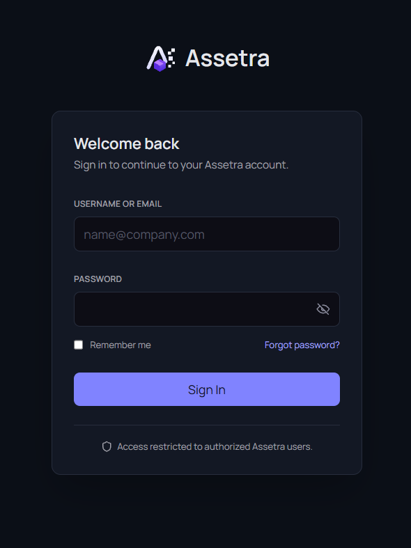
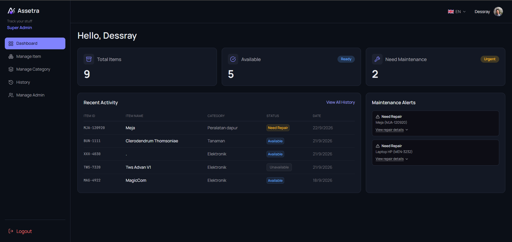
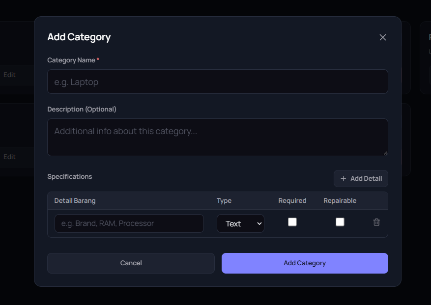
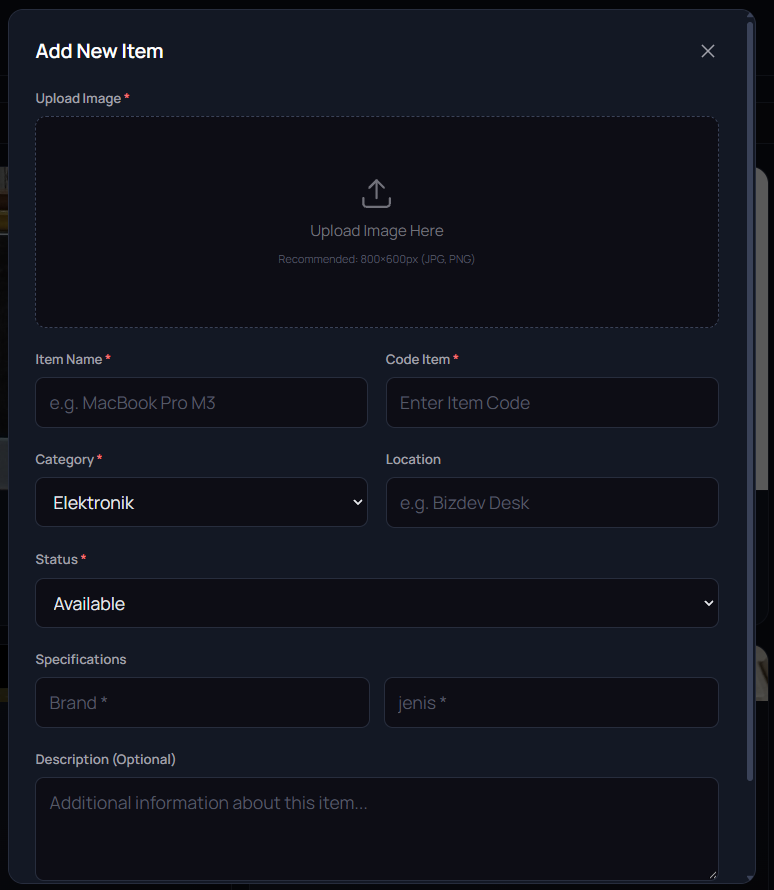
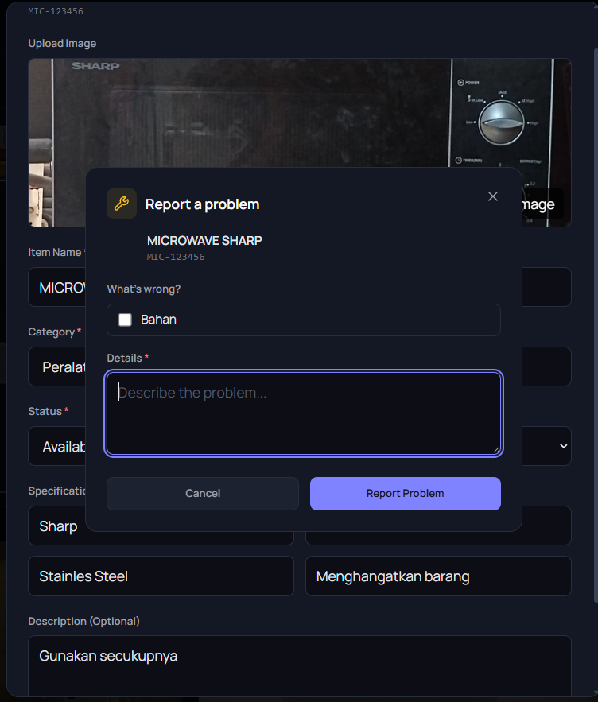
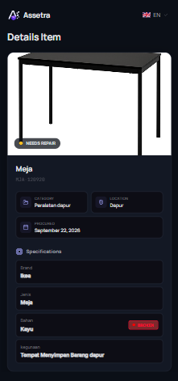
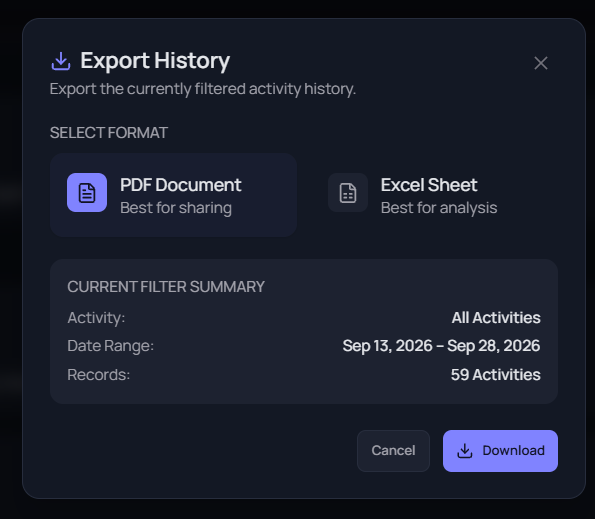

# Assetra - User Manual

Panduan pemakaian aplikasi Assetra untuk Admin, Super Admin, dan Guest.

Aplikasi: https://assetra-navy.vercel.app
Video demo (5 menit): _(isi link Google Drive)_

## Daftar Isi

1. [Pengantar](#1-pengantar)
2. [Login & Lupa Password](#2-login--lupa-password)
3. [Dashboard](#3-dashboard)
4. [Mengelola Kategori](#4-mengelola-kategori)
5. [Mengelola Barang](#5-mengelola-barang)
6. [QR Code](#6-qr-code)
7. [History & Export](#7-history--export)
8. [Mengelola Admin (Super Admin)](#8-mengelola-admin-super-admin)
9. [Profil](#9-profil)
10. [Ganti Bahasa](#10-ganti-bahasa)
11. [FAQ / Troubleshooting](#11-faq--troubleshooting)

## 1. Pengantar

Assetra dipakai untuk mencatat dan melacak barang. Setiap barang punya QR code. Siapa pun yang memindai QR dapat melihat info dan status barang, sedangkan Admin yang sudah login bisa langsung mengubahnya.

| Peran       | Bisa apa                                                                |
| ----------- | ----------------------------------------------------------------------- |
| Guest       | Scan QR dan melihat info barang                                         |
| Admin       | Kelola kategori & barang, ubah status, cetak QR, lihat & export history |
| Super Admin | Semua fitur Admin + kelola akun Admin                                   |

## 2. Login & Lupa Password

### Login

1. Buka https://assetra-navy.vercel.app.
2. Isi email dan password.
3. (Opsional) centang **Remember Me** agar tetap login di browser ini.
4. Klik **Login**.

### Lupa password

1. Di halaman login, klik **Forgot Password**.
2. Masukkan email akun, lalu klik kirim.
3. Cek email, masukkan kode OTP 6 digit.
4. Isi password baru, lalu simpan.

> Kode OTP punya batas waktu. Jika kedaluwarsa, minta kode baru.

## 3. Dashboard

Setelah login, Dashboard menampilkan ringkasan jumlah barang per status dan tabel **Barang Perlu Perhatian** (barang yang rusak). Klik ikon panah di kolom Detail untuk langsung membuka detail barang tersebut.

Menu samping: Dashboard, Manage Items, Manage Categories, History, dan Manage Admin (khusus Super Admin).

## 4. Mengelola Kategori

Kategori menentukan spesifikasi apa saja yang diisi pada barang (mis. kategori Laptop punya spesifikasi RAM, Processor).

### Menambah kategori

1. Buka **Manage Categories**.
2. Klik **Add New Category**.
3. Isi nama kategori dan deskripsi (opsional).
4. Di bagian **Specifications**, isi minimal satu spesifikasi:
   - **Nama** spesifikasi
   - **Tipe**: text, number, date, atau boolean
   - **Required**: wajib diisi saat input barang
   - **Repairable**: spesifikasi ini bisa dipilih sebagai bagian yang rusak
5. Klik **Add Detail** untuk menambah baris, atau ikon hapus untuk membuang baris.
6. Klik **Add Category**.

### Mengubah / menghapus kategori

- Klik **Edit** pada kategori, ubah data, lalu **Save Changes**.
- Klik **Delete** untuk menghapus. Kategori yang masih dipakai barang **tidak bisa** dihapus.

## 5. Mengelola Barang

### Menambah barang

1. Buka **Manage Items** lalu klik **Add Item**.
2. Pilih kategori. Kolom spesifikasi akan muncul otomatis.
3. Isi nama, lokasi, status, foto (opsional), dan spesifikasi.
4. Klik simpan. Kode barang dan QR code dibuat otomatis.

### Melihat detail

Klik satu kartu barang. Panel detail muncul berisi info, spesifikasi, deskripsi kerusakan (jika ada), dan riwayat perubahan barang.

### Mengubah barang

1. Klik barang, lalu pilih **Edit**.
2. Ubah data, lalu simpan.

### Melaporkan kerusakan (Need Repair)

1. Pada form edit, ubah **Status** menjadi **Needs Repair**.
2. Jendela **Need Repair** muncul:
   - Pilih bagian yang rusak (centang spesifikasi)
   - Isi detail kerusakan. Wajib jika tidak ada yang dicentang
3. Klik konfirmasi. Jika dibatalkan, status kembali ke semula.

### Menonaktifkan barang

1. Pilih barang (bisa lebih dari satu) lalu klik **Deactivate**, atau ubah status menjadi **Unavailable**.
2. Isi alasan penonaktifan lalu konfirmasi.

### Mencari & memfilter

Gunakan kotak pencarian, atau tombol filter untuk memilih status, kategori, dan rentang tanggal.

## 6. QR Code

### Mencetak QR

1. Buka halaman cetak QR (**Print QR**) dari barang yang dipilih.
2. Pilih barang, lalu cetak.
3. Tempel QR pada barang.

> QR hanya berisi link ke halaman barang, jadi tetap berlaku walaupun data barang diubah.

### Memindai QR

1. Scan QR dengan kamera HP.
2. Halaman barang terbuka.
   - **Guest**: hanya melihat info dan status.
   - **Admin yang sudah login**: tombol **Edit** dan **Deactivate** tersedia.

## 7. History & Export

Halaman **History** mencatat semua aktivitas: tambah barang, edit barang, laporan kerusakan, penonaktifan barang, dan perubahan akun admin, lengkap dengan siapa yang melakukan dan kapan.

### Memfilter

Gunakan pencarian, filter tipe aktivitas, dan rentang tanggal. Pindah halaman lewat nomor halaman di bawah.

### Export

1. Klik **Export**.
2. Pilih format **PDF** atau **Excel**.
3. Atur filter jika perlu, lalu unduh.

File berisi tabel riwayat dan ringkasan bulanan (barang ditambah, perlu perbaikan, tidak tersedia, selesai diperbaiki).

## 8. Mengelola Admin (Super Admin)

1. Buka **Manage Admin**.
2. **Tambah admin**: klik **Add Admin**, isi data, simpan.
3. **Nonaktifkan admin**: ubah toggle status, isi alasan, konfirmasi.

Kolom **Last Activity** menampilkan login terakhir admin, atau **Inactive** jika akun dinonaktifkan.

## 9. Profil

Buka menu **Profile** dari header.

| Aksi        | Cara                                                                                                                |
| ----------- | ------------------------------------------------------------------------------------------------------------------- |
| Ganti foto  | Klik ikon kamera di avatar                                                                                          |
| Ganti nama  | Klik ikon pensil di samping nama, ubah, simpan                                                                      |
| Ganti email | Klik **Change** pada email, masukkan email baru, lalu masukkan kode OTP 6 digit yang dikirim ke email baru tersebut |

## 10. Ganti Bahasa

Klik pemilih bahasa di header untuk beralih antara **English** dan **Indonesia**.

## 11. FAQ / Troubleshooting

| Masalah                                 | Solusi                                                                                                                        |
| --------------------------------------- | ----------------------------------------------------------------------------------------------------------------------------- |
| Tidak bisa login                        | Periksa email/password. Jika lupa, gunakan **Forgot Password**. Akun yang dinonaktifkan tidak bisa login, hubungi Super Admin |
| Kode OTP tidak masuk                    | Cek folder spam, tunggu beberapa saat, lalu minta kirim ulang                                                                 |
| Kategori tidak bisa dihapus             | Masih ada barang yang memakai kategori itu. Pindahkan atau nonaktifkan barangnya dulu                                         |
| Setelah scan QR hanya bisa melihat info | Anda belum login di browser itu. Login sebagai Admin lalu scan ulang                                                          |
| Halaman loading terus                   | Cek koneksi internet, lalu refresh halaman                                                                                    |
| Gambar gagal diunggah                   | Coba lagi dengan file lebih kecil; jika masih gagal, hubungi developer                                                        |

## Kontak Support

_(Dessray/anggatyan2@gmail.com)_
